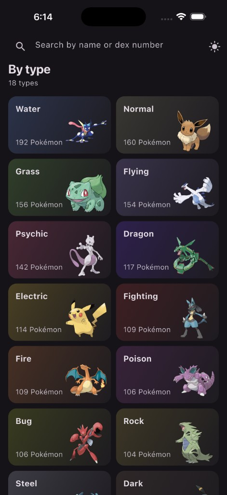
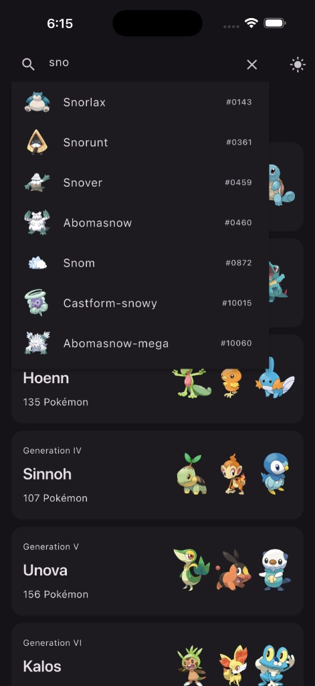
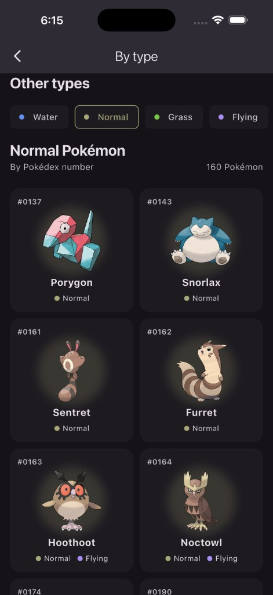
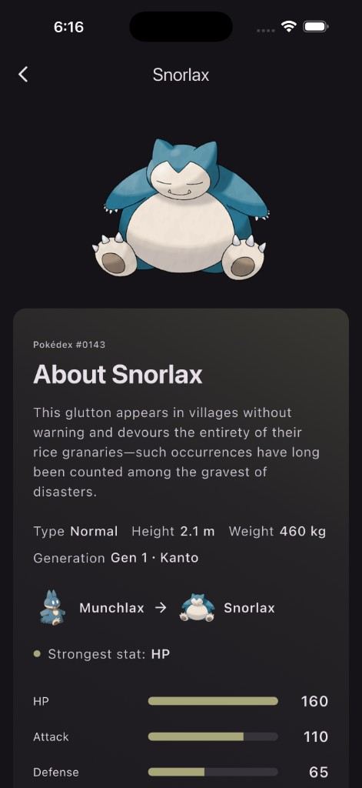

# Pokémon 圖鑑

把寶可夢塞進 Flutter 的口袋圖鑑，打幾個字就能搜到、點屬性或世代隨便逛，進詳情追完整條進化鏈與種族值。

## 功能

- 搜尋寶可夢（**自動完成**）；首頁依**屬性**、**世代**瀏覽，圖鑑列表可**看更多**載入
- 詳情頁：**進化鏈**、**種族值**（六項能力條）等
- 淺色／深色主題切換

## 畫面預覽

| 首頁 | 搜尋（自動完成） |
|:---:|:---:|
|  |  |

| 屬性列表 | 詳情頁 |
|:---:|:---:|
|  |  |

## 執行

環境：[Flutter](https://docs.flutter.dev/get-started/install)、[Xcode](https://developer.apple.com/xcode/)（iOS 模擬器）。

```bash
git clone <repository-url>
cd pokemon
flutter pub get
```

iOS 模擬器就緒後，在 IDE 開啟 `lib/main.dart`，以 **Run Without Debugging**（或 `flutter run`）啟動。

## 專案結構（摘要）

### Data

| 路徑 | 說明 |
|------|------|
| `lib/services/api.dart` | PokéAPI HTTP 與 JSON 解析 |

### Screens

| 路徑 | 說明 |
|------|------|
| `lib/screens/pokemon_list_screen.dart` | 首頁：搜尋、屬性／世代入口、看更多分頁 |
| `lib/screens/pokemon_detail_screen.dart` | 詳情：介紹、進化鏈、種族值 |
| `lib/screens/pokemon_type_screen.dart` | 單一屬性下的寶可夢列表 |
| `lib/screens/pokemon_generation_screen.dart` | 單一世代下的寶可夢列表 |

### Models

| 路徑 | 說明 |
|------|------|
| `lib/models/pokemon.dart` | `Pokemon` - 單隻詳情（含 `strongestStat`） |
| `lib/models/pokemon_stat.dart` | `PokemonStat` - 單項種族值 |
| `lib/models/pokemon_list_item.dart` | `PokemonListItem` - 列表 |
| `lib/models/type_info.dart` | `TypeInfo` - 屬性 |
| `lib/models/generation_info.dart` | `GenerationInfo` - 世代 |
| `lib/models/evolution_chain.dart` | `EvolutionChainInfo` - 進化鏈 |

### Theme

| 路徑 | 說明 |
|------|------|
| `lib/theme/type_colors.dart` | `typeColor`、`cardSurface` |
| `lib/theme/type_mascots.dart` | 各屬性代表圖 |
| `lib/theme/region_starters.dart` | 各世代代表圖 |
| `lib/theme/spacing.dart` | `AppSpacing` 版面間距 |

### Widgets

| 路徑 | 說明 |
|------|------|
| `lib/widgets/search_field.dart` | `SearchField` - 搜尋與 `Autocomplete` |
| `lib/widgets/pokemon_grid.dart` | `PokemonGrid` - 網格列表 |
| `lib/widgets/section_header.dart` | `SectionHeader` - 區塊標題 |
| `lib/widgets/chip_row.dart` | `ChipRow` - 篩選 chip 列 |

### Extension

| 路徑 | 說明 |
|------|------|
| `lib/extensions/string_capitalized.dart` | 名稱字首大寫擴充 |

## 資料來源

<p>
  <a href="https://pokeapi.co/" style="text-decoration: none; color: inherit">
    <span style="display: inline-flex; align-items: flex-start; gap: 3px">
      <span>PokeAPI</span>
      
    </span>
  </a>
</p>